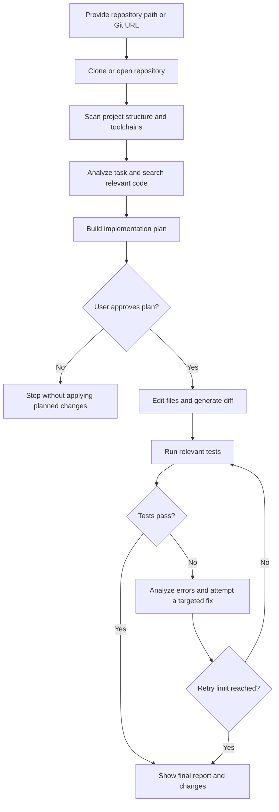
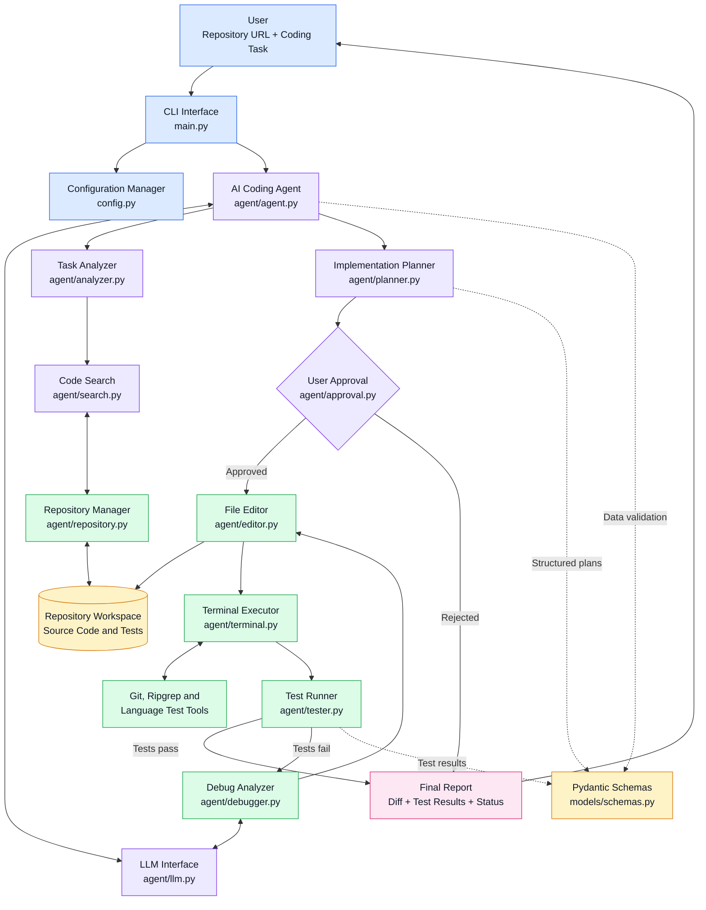

# Autonomous AI Coding Agent

A modular Python command-line AI coding assistant that helps inspect existing repositories, understand project structure, plan code changes, request approval, edit files, run tests, analyze failures, and iteratively attempt fixes.

The goal is to bring several software-development steps into one workflow instead of manually searching a codebase, editing files, running tests, and debugging each failure separately.

## Table of Contents

* [Overview](#overview)
* [Key Features](#key-features)
* [How It Works](#how-it-works)
* [Architecture](#architecture)
* [Supported Languages and Toolchains](#supported-languages-and-toolchains)
* [Requirements](#requirements)
* [Installation](#installation)
* [Configuration](#configuration)
* [Usage](#usage)
* [Running Tests](#running-tests)
* [Safety Notes](#safety-notes)
* [Project Structure](#project-structure)
* [Technology Stack](#technology-stack)
* [Limitations](#limitations)
* [Future Improvements](#future-improvements)
* [Contributing](#contributing)
* [License](#license)

## Overview

The AI Coding Agent accepts a local repository path or a Git repository URL and a task written in natural language. It scans the repository, identifies relevant files and code symbols, prepares a structured implementation plan, and—after approval unless auto-approval is enabled—attempts the requested changes.

After editing, it can run an appropriate test command, inspect failures, attempt targeted fixes, and rerun tests up to a configured retry limit. A final terminal report summarizes the result and displays a unified diff when changes were made.

**Important:** This tool assists with code changes; it does not guarantee that generated changes are correct, secure, or production-ready. Always review diffs and test results before merging or deploying changes.

## Key Features

* **Repository intake:** Open a local project or clone a remote Git repository.
* **Project inspection:** Detect repository files, languages, package managers, build systems, and test runners.
* **Code search:** Search text, symbols, references, and file patterns using Ripgrep when available, with a Python fallback.
* **Task analysis:** Extract relevant keywords and related terms to find useful context without sending the entire repository to the language model.
* **Implementation planning:** Generate a structured plan before making changes.
* **Approval workflow:** Review and approve or reject a plan before editing; optional auto-approval is available for trusted workflows.
* **Guarded file editing:** Apply file changes, generate unified diffs, and use rollback-related editing logic.
* **Test execution:** Dispatch to detected test runners and parse their results.
* **Iterative debugging:** Use failure output and tracebacks to propose targeted fixes and rerun tests within a configurable limit.
* **Terminal interface:** Present repository information, progress, diffs, and test summaries in the terminal using Rich.
* **Configurable LLM integration:** Use the OpenAI SDK with a configured model or an OpenAI-compatible endpoint; a mock provider is included for testing workflows.
* **Automated tests:** Unit and end-to-end tests cover core subsystems.

## How It Works



### Agent lifecycle

The orchestrator coordinates the following general stages:

1. Load or clone the target repository.
2. Scan files and identify languages and build/test tools.
3. Analyze the requested task.
4. Search for relevant files, symbols, and snippets.
5. Build a focused context for the language model.
6. Generate a step-by-step implementation plan.
7. Request approval when interactive approval is enabled.
8. Apply the proposed file edits.
9. Produce a diff for review.
10. Run relevant tests or verification commands.
11. Parse exit codes, output, and error traces.
12. Diagnose failures and propose targeted fixes.
13. Apply a repair attempt when appropriate.
14. Rerun tests.
15. Repeat until tests pass or the configured retry limit is reached.
16. Display a summary of the task, changes, and test results.

The exact path depends on the task, repository contents, provider configuration, and available test tools.

## Architecture

The project uses a modular, single-responsibility design:

| Module                    | Responsibility                                                                    |
| ------------------------- | --------------------------------------------------------------------------------- |
| `main.py`                 | Command-line interface, arguments, repository overview, and final report          |
| `config.py`               | Loads environment settings and execution limits                                   |
| `agent/agent.py`          | Coordinates the end-to-end coding workflow                                        |
| `agent/llm.py`            | Language-model client interface and provider implementations                      |
| `agent/repository.py`     | Repository cloning, scanning, and project/toolchain detection                     |
| `agent/search.py`         | Text, symbol, and reference search                                                |
| `agent/analyzer.py`       | Task keyword analysis and focused context building                                |
| `agent/planner.py`        | Structured implementation-plan generation                                         |
| `agent/approval.py`       | Interactive approval and auto-approval handling                                   |
| `agent/editor.py`         | File editing, diff generation, and editing safeguards                             |
| `agent/terminal.py`       | Command execution, timeout handling, and safety checks                            |
| `agent/tester.py`         | Test command selection and result parsing                                         |
| `agent/debugger.py`       | Failure analysis and iterative repair workflow                                    |
| `models/schemas.py`       | Pydantic data models for plans, repository information, changes, and test results |
| `tests/`                  | Unit and end-to-end tests                                                         |
| `workspace/repositories/` | Default location for repositories cloned by the agent                             |

## Supported Languages and Toolchains

The repository scanner and test dispatcher are designed to recognize common project ecosystems, including:

| Language                | Common project files / tools                       |
| ----------------------- | -------------------------------------------------- |
| Python                  | `pyproject.toml`, `setup.py`, `pytest`, `unittest` |
| JavaScript / TypeScript | `package.json`, `tsconfig.json`, npm, Jest, Vitest |
| Rust                    | `Cargo.toml`, Cargo                                |
| Go                      | `go.mod`, `go test`                                |
| Java                    | Maven (`pom.xml`), Gradle                          |
| C / C++                 | `CMakeLists.txt`, `Makefile`, CMake, Make, CTest   |

Detection and test execution depend on the repository layout and the relevant toolchain being installed. Recognition does not mean every project or framework has been tested.

## Requirements

* Python **3.11 or newer**
* Git installed and available on your system `PATH`
* An LLM provider and valid credentials for model-backed coding tasks
* The relevant language runtimes/build tools installed if you want to run a repository's tests (for example, Node.js, Cargo, Go, Maven, or CMake)
* Optional: [Ripgrep](https://github.com/BurntSushi/ripgrep) for faster code search; the agent includes a Python fallback

The project dependencies are listed in `requirements.txt`, including Pydantic, Rich, `python-dotenv`, the OpenAI SDK, and pytest.

## Installation

### 1. Clone this project

```bash
git clone <YOUR-REPOSITORY-URL>
cd ai-coding-agent
```

Replace `<YOUR-REPOSITORY-URL>` with the URL of the GitHub repository where you publish this project.

If you downloaded the source as a ZIP, extract it and open a terminal in the `ai-coding-agent` folder instead.

### 2. Create a virtual environment (recommended)

**Windows — PowerShell:**

```powershell
py -3.11 -m venv .venv
.\.venv\Scripts\Activate.ps1
```

**Windows — Command Prompt:**

```bat
py -3.11 -m venv .venv
.venv\Scripts\activate.bat
```

**Linux / macOS:**

```bash
python3 -m venv .venv
source .venv/bin/activate
```

If Python 3.11+ is already installed under the `python` command, you can use `python -m venv .venv` instead.

### 3. Install dependencies

```bash
python -m pip install --upgrade pip
python -m pip install -r requirements.txt
```

### 4. Configure environment variables

Copy `.env.example` to `.env`.

**Windows PowerShell:**

```powershell
Copy-Item .env.example .env
```

**Windows Command Prompt:**

```bat
copy .env.example .env
```

**Linux / macOS:**

```bash
cp .env.example .env
```

Open `.env` in a text editor and set the provider and credentials you intend to use. Do not commit `.env` or real API keys to GitHub.

## Configuration

The project includes an `.env.example` template:

```dotenv
# LLM Configuration
LLM_PROVIDER=openai
LLM_MODEL=gpt-4o-mini
LLM_API_KEY=your_openai_api_key_here
LLM_BASE_URL=

# Agent Execution Limits
MAX_DEBUG_ITERATIONS=3
COMMAND_TIMEOUT=120
AUTO_APPROVE=false

# Workspace Paths
WORKSPACE_DIR=./workspace/repositories
```

| Variable               | Purpose                                                           |
| ---------------------- | ----------------------------------------------------------------- |
| `LLM_PROVIDER`         | Selects the configured provider (for example, `openai` or `mock`) |
| `LLM_MODEL`            | Model name to use                                                 |
| `LLM_API_KEY`          | API key for the selected hosted provider, if required             |
| `LLM_BASE_URL`         | Optional custom endpoint for a compatible provider                |
| `MAX_DEBUG_ITERATIONS` | Maximum number of automated debugging iterations                  |
| `COMMAND_TIMEOUT`      | Command execution timeout, in seconds                             |
| `AUTO_APPROVE`         | Enables plan auto-approval when set to a recognized true value    |
| `WORKSPACE_DIR`        | Directory used for cloned repositories                            |

A custom `LLM_BASE_URL` may be usable with compatible services such as Ollama, vLLM, DeepSeek, Groq, or OpenRouter, depending on that provider's API compatibility and configuration. Follow the provider's current documentation.

## Usage

Run these commands from the root of the project.

### Work on a local repository

```bash
python main.py --repo "C:/path/to/your/project" --task "Fix the authentication token expiry bug"
```

On Linux or macOS, use a path such as `--repo "/home/you/projects/sample-project"`.

### Clone and work on a remote repository

```bash
python main.py --repo "https://github.com/OWNER/REPOSITORY.git" --task "Add unit tests for user registration"
```

Replace the example URL with a repository you have permission to access. Private repositories may require Git credentials or additional setup.

### Review a plan interactively

Interactive approval is the default unless auto-approval is enabled:

```bash
python main.py --repo "./sample-project" --task "Fix the calculation error"
```

Review the proposed plan and follow the prompts before allowing changes.

### Use interactive task entry

```bash
python main.py --repo "./sample-project" --interactive
```

The agent will prompt for a coding task.

### Auto-approve a task

```bash
python main.py --repo "./sample-project" --task "Fix the calculation error" --auto-approve
```

**Use auto-approval only for repositories and tasks you trust.** It removes the interactive plan approval step; it does not remove the need to review resulting code.

### Select a provider or model from the command line

```bash
python main.py --repo "./sample-project" --task "Explain and fix the failing test" --provider openai --model gpt-4o-mini
```

### See available command-line options

```bash
python main.py --help
```

## Running Tests

Install the project dependencies, then run the test suite from the project root:

```bash
pytest tests -v
```

The test modules cover repository detection, searching, terminal safeguards, file editing, test-result parsing, debugging behavior, and an end-to-end agent workflow.

The project documentation describes a suite of 12 automated tests. Test counts and results can change as the code evolves, so run the command above against your checkout to confirm the current status. A passing test suite does not guarantee that every generated code change is correct or safe.

## Safety Notes

The project includes safeguards such as repository-root path validation, command timeouts, a destructive-command blocklist, and approval controls. These are defense-in-depth measures, **not a guarantee of complete isolation or security**.

Before using the agent on important code:

* Use a disposable clone, a branch, or a clean working tree.
* Review the proposed plan and every diff.
* Keep backups and commit or stash existing work.
* Do not run it against production systems or sensitive repositories without an appropriate security review.
* Be careful with auto-approval, custom LLM endpoints, and commands that may change or delete data.
* Remember that source code and prompts sent to hosted LLM providers may be processed under those providers' terms and privacy policies.
* Never publish API keys, access tokens, passwords, or private repository data in this repository.

## Project Structure

```text
ai-coding-agent/
├── main.py
├── config.py
├── requirements.txt
├── .env.example
├── agent/
│   ├── __init__.py
│   ├── agent.py
│   ├── analyzer.py
│   ├── approval.py
│   ├── debugger.py
│   ├── editor.py
│   ├── llm.py
│   ├── planner.py
│   ├── repository.py
│   ├── search.py
│   ├── terminal.py
│   └── tester.py
├── models/
│   ├── __init__.py
│   └── schemas.py
├── workspace/
│   └── repositories/
└── tests/
    ├── __init__.py
    ├── test_debugger.py
    ├── test_e2e_agent.py
    ├── test_editor.py
    ├── test_repository.py
    ├── test_search.py
    ├── test_terminal.py
    └── test_tester.py
```
## Architecture Diagram

The AI Coding Agent follows a modular architecture in which the CLI manages user input, the core agent coordinates specialized modules, and external tools execute repository operations, tests, and debugging tasks.



### Main Components

| Component             | Responsibility                                      |
| --------------------- | --------------------------------------------------- |
| CLI and Configuration | Accept coding tasks and load settings               |
| AI Agent              | Coordinate the coding and debugging workflow        |
| Analyzer and Search   | Identify relevant files, symbols, and code context  |
| LLM and Planner       | Understand tasks and generate implementation plans  |
| Approval Handler      | Allow the user to approve or reject proposed work   |
| Editor and Terminal   | Modify files and execute commands                   |
| Tester and Debugger   | Run tests, analyze failures, and attempt fixes      |
| Repository Manager    | Clone and inspect repositories                      |
| Workspace             | Store the target repository and its files           |
| Pydantic Schemas      | Validate structured data between modules            |
| Final Report          | Present changes, test results, and execution status |

### Workflow Summary

1. The user supplies a repository and describes a coding task.
2. The agent scans the project and searches for relevant code.
3. The LLM helps analyze the task and create an implementation plan.
4. The user reviews and approves the plan.
5. The editor applies changes and the terminal executes relevant commands.
6. The tester verifies the changes.
7. If tests fail, the debugger attempts a targeted repair and reruns the tests.
8. The agent reports the resulting changes and test status.

## Technology Stack

* **Python 3.11+** — core language
* **OpenAI SDK** — hosted and compatible LLM integration
* **Pydantic** — structured schemas and validation
* **Rich** — readable terminal output, tables, and diffs
* **python-dotenv** — environment configuration
* **pytest** — automated testing
* **Python standard library** — process execution, path handling, regular expressions, file matching, timing, and diff generation
* **Git** — repository cloning and version-control operations

## Limitations

* LLM output can be incorrect, incomplete, or inconsistent with a project's conventions.
* The quality of plans and code changes depends on the selected model, task description, and available repository context.
* Test-runner detection is heuristic and depends on installed tools and project configuration.
* A passing test suite only validates the tests that actually ran.
* Some projects may require manual setup, environment variables, databases, services, or credentials before their tests can run.
* Security safeguards reduce risk but should not be treated as a hardened operating-system sandbox.

## Future Improvements

Potential directions for future development include:

* Add a dry-run mode that produces a plan and diff without applying changes.
* Add richer repository-level configuration and ignore rules.
* Improve language-server integration and semantic code navigation.
* Add structured logs and exportable HTML/Markdown reports.
* Add broader test fixtures for more languages and real-world repository layouts.
* Add configurable approval policies for different classes of changes.
* Improve isolation for executing untrusted repository code.

These are possible extensions, not claims that the features are already implemented.

## Contributing

Contributions, bug reports, and suggestions are welcome.

1. Fork the repository.
2. Create a feature branch.
3. Make a focused change and add or update tests.
4. Run `pytest tests -v`.
5. Open a pull request describing the change and its verification.

Please avoid including secrets, private source code, generated bytecode, or local environment files in pull requests.

## License

No license has been specified in this repository yet. Before publishing the project publicly, choose a license and add a `LICENSE` file if you want to define how others may use, modify, and distribute the code.
   
